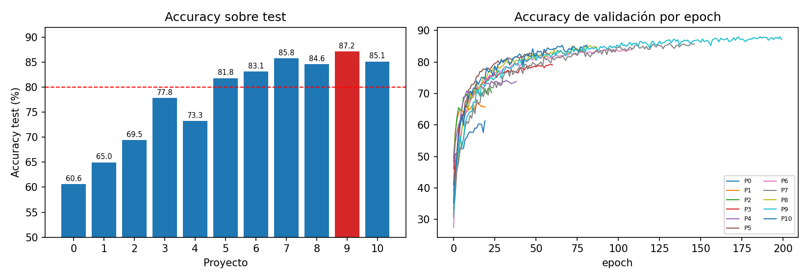
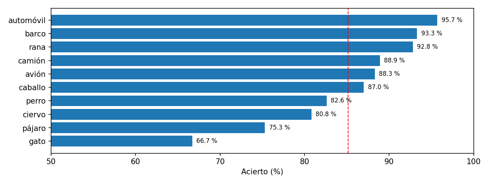

# Clasificación de imágenes CIFAR-10 con redes convolucionales

Proyecto IV del módulo de Deep Learning del **Máster en Data Science & AI (Nuclio Digital School, 2026)**.

El objetivo es entrenar una red convolucional con Keras que clasifique las imágenes de CIFAR-10 con al menos un **80 % de accuracy sobre test**, mediante **10 proyectos iterativos**. Cada proyecto introduce un cambio justificado por lo que se observó en el anterior.

**Resultado:** de un **60,58 %** en la línea base a un **87,18 %** en el mejor modelo (Proyecto 9). El objetivo del 80 % se alcanza en el Proyecto 5.



## Dataset

[CIFAR-10](https://www.cs.toronto.edu/~kriz/cifar.html): 60.000 imágenes en color de 32×32 píxeles repartidas en 10 clases (avión, automóvil, pájaro, gato, ciervo, perro, rana, caballo, barco y camión).

- 40.000 imágenes de entrenamiento
- 10.000 de validación (las últimas del conjunto de entrenamiento original)
- 10.000 de test, que solo se usan para la accuracy final

Los píxeles se normalizan a [0, 1].

## Metodología

En cada proyecto se analizan las curvas de loss y accuracy: el epoch del mejor modelo, la distancia entre train y validación y si el loss de validación baja, se estanca o sube. Con eso se identifica el problema principal y se decide el siguiente cambio.

A partir del Proyecto 1 se aplican estos criterios comunes:

- Early Stopping sobre `val_loss` con `patience=15` y `restore_best_weights=True`.
- Máximo de 100 epochs, ampliado a 200 desde el Proyecto 6.
- Red creada desde cero en cada proyecto, con `clear_session()` y la semilla fijada (`set_random_seed(42)`).
- Inicialización `he_uniform` y `padding='same'` en las convoluciones.
- Optimizador Adam y `sparse_categorical_crossentropy`.

## Resultados

| P. | Cambio | Accuracy test | Mejor epoch / epochs | Parámetros |
|---|---|---|---|---|
| 0 | Línea base (código del enunciado) | 60,58 % | 20 / 20 | 263.402 |
| 1 | Primer bloque VGG + capa densa de 128 | 64,98 % | 5 / 20 | 1.060.138 |
| 2 | Segundo bloque VGG | 69,46 % | 9 / 24 | 591.274 |
| 3 | Dropout | 77,83 % | 46 / 61 | 591.274 |
| 4 | Quitar el Dropout de las convoluciones | 73,26 % | 24 / 39 | 591.274 |
| 5 | Tercer bloque VGG | 81,82 % | 44 / 59 | 550.570 |
| 6 | Learning rate 0,0005 | 83,12 % | 94 / 109 | 550.570 |
| 7 | Data augmentation | 85,81 % | 132 / 147 | 550.570 |
| 8 | Batch size 256 | 84,58 % | 73 / 88 | 550.570 |
| 9 | Capa densa de 512 neuronas | **87,18 %** | 191 / 200 | 1.341.226 |
| 10 | Learning rate 0,001 | 85,14 % | 67 / 82 | 1.341.226 |

La cadena de decisiones fue la siguiente:

- **P0 → P1.** La red base entrena poco y el 99,5 % de sus parámetros está en la capa densa. Se añade un bloque VGG.
- **P1 → P2.** Aparece overfitting temprano por una capa densa enorme. Se añade un segundo bloque VGG, que reduce a la mitad los parámetros de la capa densa.
- **P2 → P3.** El overfitting persiste. Se añade Dropout (+8,37 puntos, la mayor mejora).
- **P3 → P4 → P5.** El modelo se estanca. Quitar el Dropout de las convoluciones empeora el resultado, lo que indica que falta capacidad. Un tercer bloque VGG supera el 80 %.
- **P5 → P6.** El loss de validación oscila. Se baja el learning rate a 0,0005.
- **P6 → P7.** El loss de validación es casi el doble que el de train. Se añade data augmentation (volteo horizontal y desplazamientos del 10 %).
- **P7 → P8 → P9.** El modelo aprende lento y el train se queda en el 85 %. El batch de 256 no ayuda; ampliar la capa densa a 512 neuronas da el mejor resultado.
- **P9 → P10.** Volver al learning rate de 0,001 acelera el aprendizaje, pero el modelo acaba peor. Cada learning rate funciona mejor en una fase distinta del entrenamiento.

### Acierto por clase (modelo del Proyecto 10)



Los vehículos se reconocen casi siempre: automóvil 95,7 % y barco 93,3 %. Los errores se concentran en los animales, sobre todo gato (66,7 %) y pájaro (75,3 %).

## Estructura del repositorio

```
├── notebooks/Proyecto_IV_CIFAR10.ipynb   # Código completo de los 11 proyectos (Google Colab)
├── results/resultados_iteracion.json     # Accuracy en test, historias de entrenamiento y parámetros
└── figures/                              # Comparativa, acierto por clase y curvas de cada proyecto
```

## Cómo ejecutarlo

1. Abre el notebook en Google Colab con GPU (T4).
2. Descarga [`cifar-10-python.tar.gz`](https://www.cs.toronto.edu/~kriz/cifar-10-python.tar.gz) y súbelo a tu Google Drive como `cifar-10-batches-py.tar.gz`. Después ajusta la ruta del `! cp` y la variable `ruta_googledrive`.
3. Ejecuta las celdas en orden. Desde el Proyecto 7 (data augmentation) cada entrenamiento tarda alrededor de una hora.

El notebook se publica sin salidas. Los resultados de cada ejecución están en `results/` y las curvas en `figures/curvas/`.

## Limitaciones y siguientes pasos

- Cada proyecto se ha entrenado una sola vez, así que las diferencias de un punto pueden deberse al azar.
- El mejor modelo (Proyecto 9) alcanzó el límite de 200 epochs sin que el Early Stopping llegara a actuar; probablemente tenía margen de mejora.
- Siguientes pasos:
  - Re-entrenar el Proyecto 9 con más epochs.
  - Combinar los learning rates con un `LearningRateScheduler`.
  - Calcular la matriz de confusión.
  - Probar transfer learning (VGG16).

## Tecnologías

Python · TensorFlow / Keras · NumPy · Matplotlib · Google Colab

---

**Autora:** Carmen Candial Garcés
